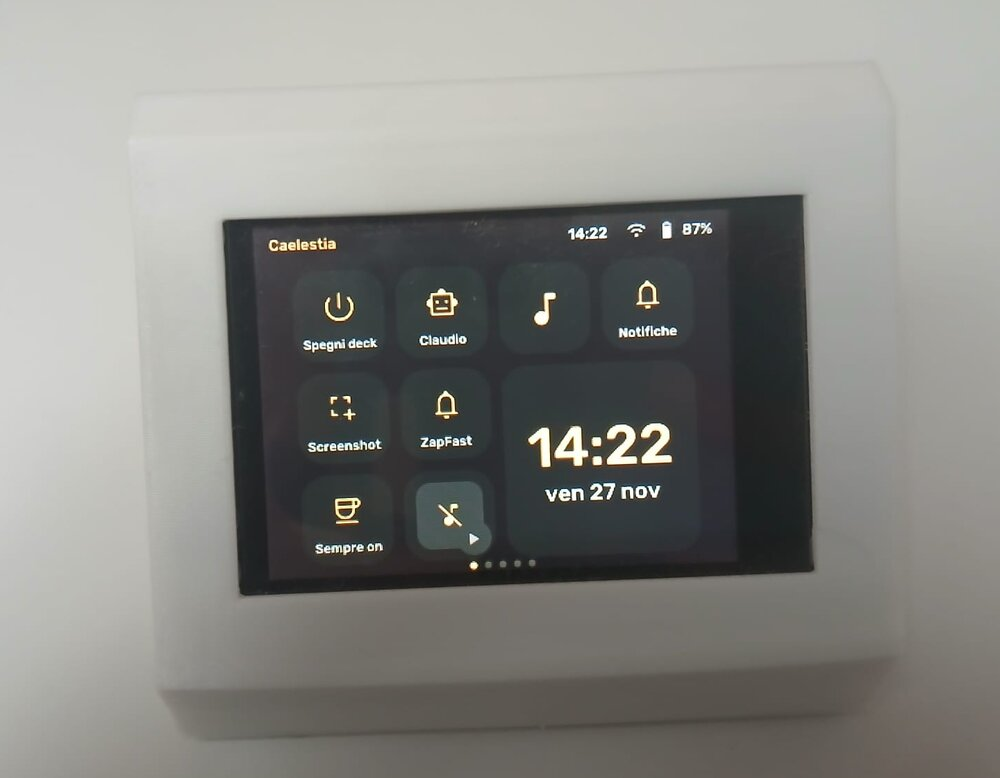
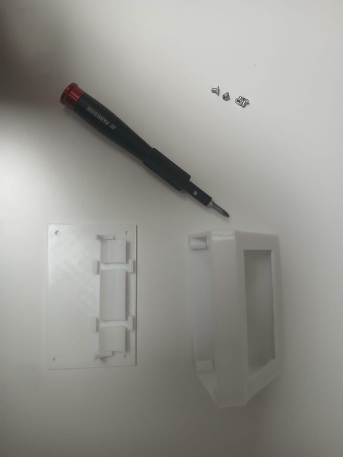
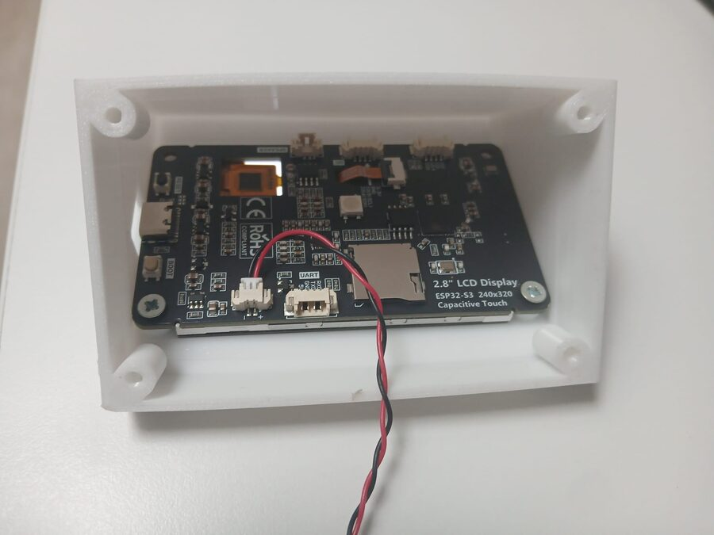
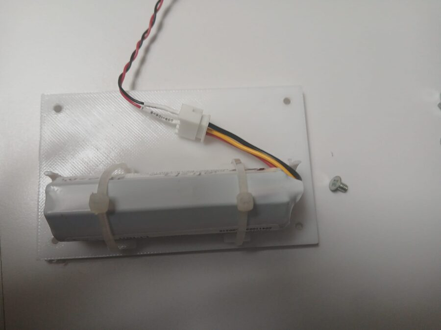
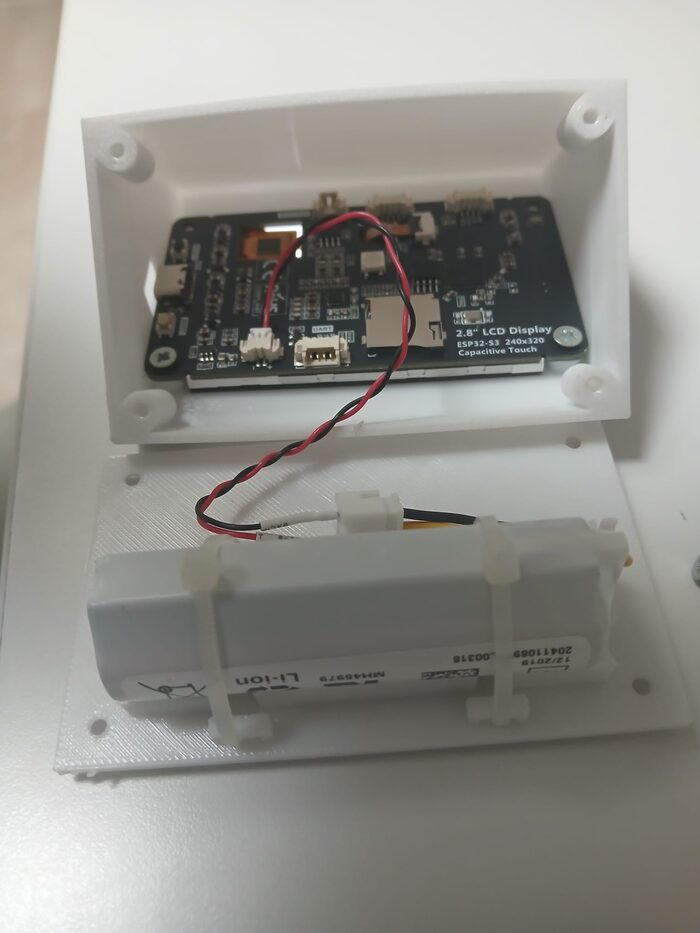
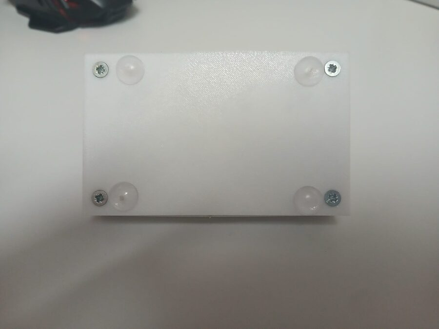
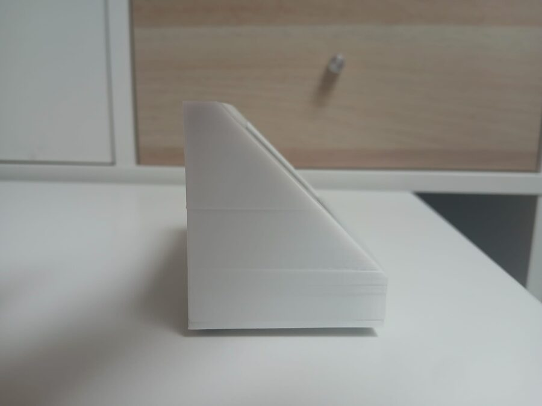

# Building a CYD Deck

🇮🇹 [Leggila in italiano](montaggio.md) · [Back to the README](../README.md)

About half an hour of work once the parts are printed. You need a screwdriver and that's it: no soldering,
no glue.

<p align="center"></p>

## What you need

| | Part | Notes |
|---|---|---|
| 1 | **Freenove FNK0104** board | ESP32-S3 with 2.8" 240×320 capacitive touch screen |
| 1 | **1S Li-ion battery pack**, 18650 size | **must have a protection circuit**, with a plug that fits the board's 2-pin battery connector (or an adapter cable) |
| 4 | **M3 countersunk screws**, ~6 mm | hold the board in the case |
| 4 | **M3 countersunk screws**, ~8–10 mm | close the bottom plate |
| 2 | **zip ties**, max 4 mm wide | hold the battery in its cradle |
| 4 | adhesive rubber feet | optional, but the deck stops sliding around |
| 1 | **USB-C cable that carries data** | some cables only charge: those won't work for flashing |
| 1 | printed **shell** + **bottom plate** | [3D files on MakerWorld](#3d-files) |

Tools: a Phillips screwdriver and something to trim the zip ties.

The screws cut their own thread in the 2.6 mm holes of the plastic: no heat-set inserts, no nuts.

## 1. Print the parts

<p align="center"></p>

Two parts, both without supports: the **shell** (print it as it is in the file, open side down) and the
**bottom plate** with the battery cradle. I printed mine in PLA on a Bambu Lab A1 mini (0.2 mm nozzle,
0.10 mm layers, 4 walls, 15% infill); a 0.4 nozzle at 0.20 mm should work too.

## 2. Flash the firmware first

Do it now, while the board is still bare and the **BOOT** and **RESET** buttons are easy to reach: once the
case is closed you can't press them anymore.

Plug the board in over USB, open the **[web flasher](https://gabritech14.github.io/cyd-deck/)** in Chrome or
Edge and click *Connect & install*. When it's done the screen says *"Waiting for the PC"*.

## 3. Mount the board in the shell

<p align="center"></p>

Lay the shell face down on something soft, so you don't scratch the screen. Drop the board in with the
display facing the window and the **USB-C port lined up with the side opening**. Fix it with the four
**short** screws. Snug is enough: overtightening strips the plastic thread, and the board must not bend.

## 4. Fix the battery to the bottom plate

<p align="center"></p>

Lay the pack in the cradle and pass two zip ties through the slots. Pull them tight so the pack doesn't
move, then trim the tails. Keep the cable on the side that faces the board.

## 5. Connect the battery

<p align="center"></p>

Plug the battery into the board's 2-pin battery connector.

⚠️ **Check the polarity before plugging it in:** red goes to **+** (it's printed on the board next to the
connector). Battery plugs aren't standardized, and a reversed one can kill the board or worse. If the
colors don't match the markings, stop and fix the cable first.

The screen should light up straight away: the board now runs on the battery and charges it whenever the
USB cable is in.

## 6. Close it up

<p align="center"></p>

Fold the cable in without pinching it, put the bottom plate on and fix it with the four **longer**
screws: the holes are countersunk, so the heads sit flush. Stick the rubber feet near the corners.

<p align="center"></p>

## 7. Set up the software

Download the desktop app (a single AppImage for Linux) from the
**[latest release](https://github.com/Gabritech14/cyd-deck/releases/latest)**, then:

```sh
chmod +x CYD_Deck-*-x86_64.AppImage
./CYD_Deck-*-x86_64.AppImage            # opens the editor and the quick-start guide
./CYD_Deck-*-x86_64.AppImage install    # app menu + start at login
```

Plug the deck in over USB once: the app sends it your Wi-Fi settings (set them in *Settings → Board
Wi-Fi*), and from then on it works unplugged. The [README](../README.md) has everything else.

## Good to know

- **Turning it off:** the "Turn the deck off" key in the Store puts it to sleep; **touch the screen** to
  wake it up (BOOT is inside the case now). For a real off, unplug the battery.
- **Battery level:** shown only by the **beta** release for now (see the README).
- **Touches land on the wrong key?** Run `calibrate` once (`./CYD_Deck…AppImage calibrate`).
- **Reflashing later:** the web flasher works with the case closed, through the USB-C port. If it can't
  find the board, it's usually the cable.

## Safety

Li-ion cells deserve respect: use a pack with a protection circuit, check the polarity, don't leave it
charging unattended, don't squash it, and stop using it if it swells. You build and use this at your own
risk.

## 3D files

On MakerWorld: *link coming*. The parametric OpenSCAD source is published there too.

---

<p align="center"><b>With love by gabritech</b> ❤️</p>
