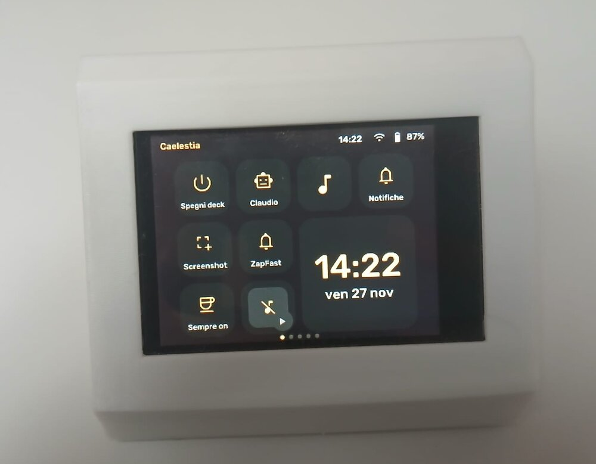
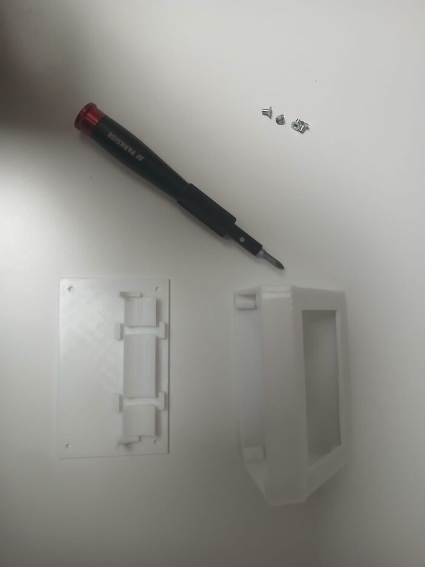
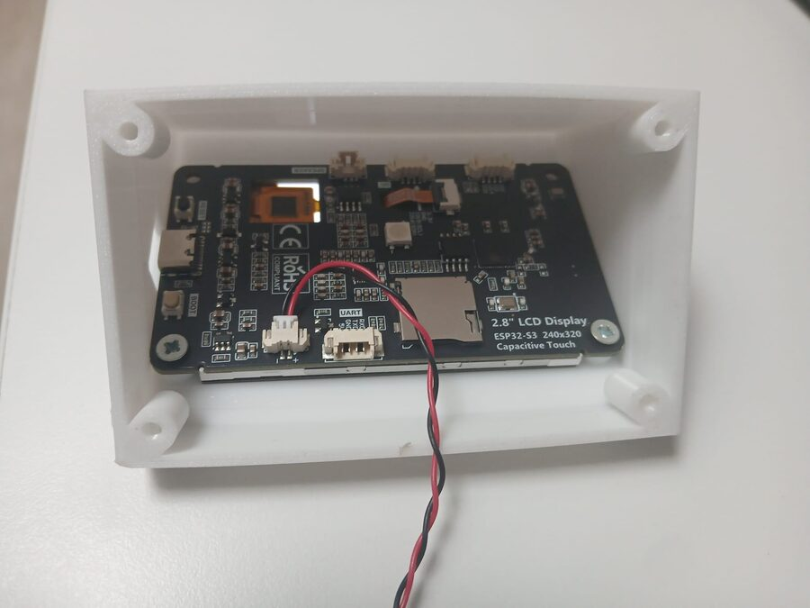
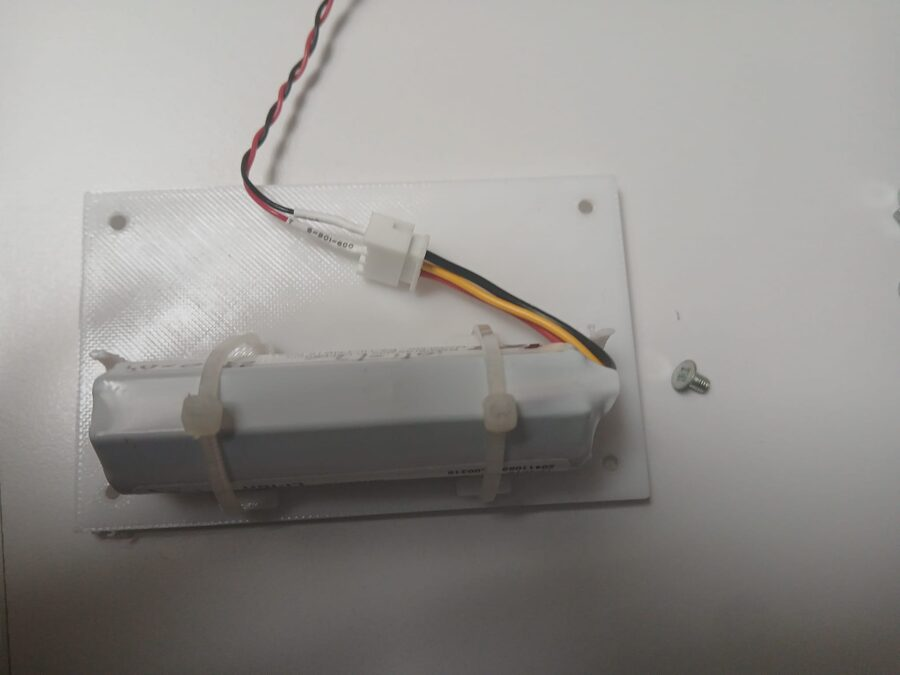
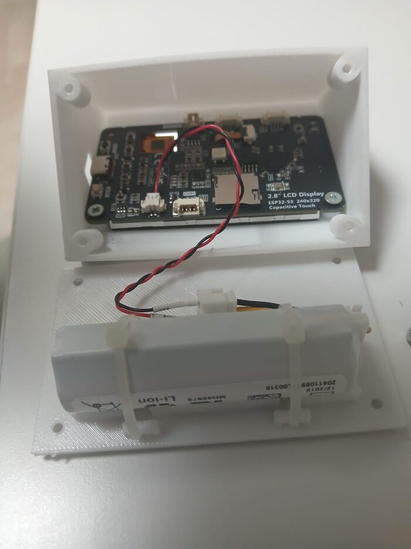
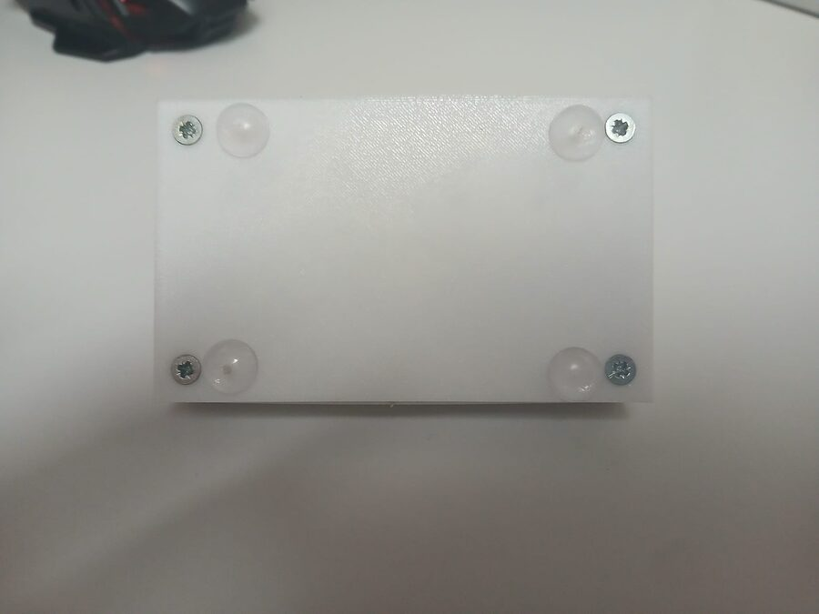
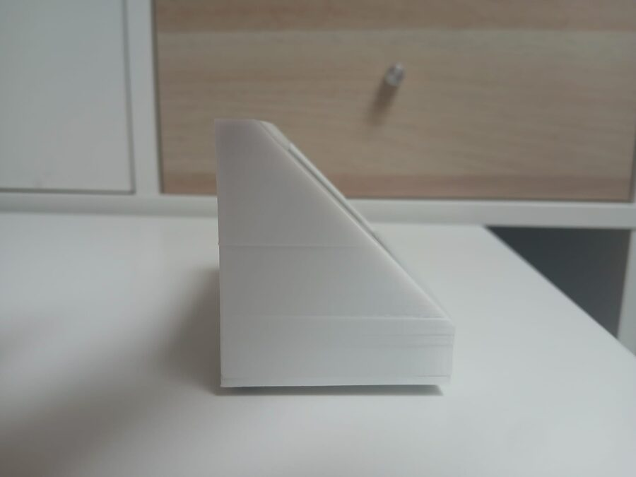

# Come montare un CYD Deck

🇬🇧 [Read it in English](assembly.md) · [Torna al README](../README.it.md)

Una mezz'oretta di lavoro, con i pezzi già stampati. Serve solo un cacciavite: niente saldature, niente
colla.

<p align="center"></p>

## Cosa serve

| | Componente | Note |
|---|---|---|
| 1 | scheda **Freenove FNK0104** | ESP32-S3 con schermo touch capacitivo da 2,8" 240×320 |
| 1 | **pacco batteria Li-ion 1S**, formato 18650 | **deve avere il circuito di protezione**, con una spina che entri nel connettore batteria a 2 poli della scheda (o un cavo adattatore) |
| 4 | **viti M3 a testa svasata**, ~6 mm | fissano la scheda nel case |
| 4 | **viti M3 a testa svasata**, ~8–10 mm | chiudono la piastra inferiore |
| 2 | **fascette**, larghe al massimo 4 mm | tengono la batteria nella culla |
| 4 | piedini adesivi in gomma | facoltativi, ma il deck non scivola più sulla scrivania |
| 1 | **cavo USB-C che porti anche i dati** | alcuni cavi caricano soltanto: con quelli il flash non va |
| 1 | **scocca** e **piastra inferiore** stampate | [file 3D su MakerWorld](https://makerworld.com/it/models/3696002-cyd-deck-freenove-cyd-2-8-case) |

Attrezzi: un cacciavite a croce e qualcosa per tagliare le fascette.

Le viti si fanno il filetto da sole nei fori da 2,6 mm della plastica: niente inserti a caldo, niente dadi.

## 1. Stampa i pezzi

<p align="center"></p>

Due pezzi, tutti e due senza supporti: la **scocca** (stampala come è nel file, lato aperto in basso) e la
**piastra inferiore** con la culla della batteria. Io li ho stampati in PLA su una Bambu Lab A1 mini (ugello
0,2 mm, layer 0,10 mm, 4 pareti, riempimento 15%); con ugello 0,4 e layer 0,20 mm dovrebbe venire bene lo
stesso.

## 2. Prima flasha il firmware

Fallo adesso, finché la scheda è nuda e i tasti **BOOT** e **RESET** si raggiungono: a case chiuso non si
possono più premere.

Collega la scheda via USB, apri il **[web flasher](https://gabritech14.github.io/cyd-deck/)** in Chrome o
Edge e clicca *Collega e installa*. Quando ha finito, sullo schermo compare *"Waiting for the PC"*.

## 3. Monta la scheda nella scocca

<p align="center"></p>

Appoggia la scocca a faccia in giù su qualcosa di morbido, per non graffiare lo schermo. Inserisci la
scheda con il display verso la finestra e la **porta USB-C allineata all'apertura laterale**. Fissala con
le quattro viti **corte**. Basta stringerle il giusto: troppo forte spani il filetto nella plastica, e la
scheda non deve flettersi.

## 4. Fissa la batteria alla piastra

<p align="center"></p>

Appoggia il pacco nella culla e passa due fascette nelle asole. Stringile perché il pacco non si muova,
poi taglia le code. Tieni il cavo dal lato che va verso la scheda.

## 5. Collega la batteria

<p align="center"></p>

Collega la batteria al connettore a 2 poli della scheda.

⚠️ **Controlla la polarità prima di collegarla:** il rosso va sul **+** (è stampato sulla scheda vicino al
connettore). Le spine delle batterie non sono tutte uguali, e una al contrario può bruciare la scheda o
peggio. Se i colori non corrispondono ai segni, fermati e sistema prima il cavo.

Lo schermo dovrebbe accendersi subito: ora la scheda va a batteria e la ricarica ogni volta che c'è il cavo
USB.

## 6. Chiudi

<p align="center"></p>

Ripiega il cavo dentro senza schiacciarlo, appoggia la piastra inferiore e fissala con le quattro viti
**lunghe**: i fori sono svasati, quindi le teste restano a filo. Attacca i piedini vicino agli angoli.

<p align="center"></p>

## 7. Prepara il software

Scarica il programma per il PC (un'unica AppImage per Linux) dall'**[ultima
versione](https://github.com/Gabritech14/cyd-deck/releases/latest)**, poi:

```sh
chmod +x CYD_Deck-*-x86_64.AppImage
./CYD_Deck-*-x86_64.AppImage            # apre l'editor e la guida iniziale
./CYD_Deck-*-x86_64.AppImage install    # menu delle app + avvio all'accesso
```

Collega il deck via USB una volta: il programma gli manda le impostazioni del Wi-Fi (le metti in
*Impostazioni → Wi-Fi della scheda*), e da lì in poi va senza cavo. Tutto il resto è nel
[README](../README.it.md).

## Buono a sapersi

- **Spegnerlo:** il tasto "Spegni il deck" dello Store lo mette a riposo; **tocca lo schermo** per
  riaccenderlo (BOOT ora è dentro il case). Per spegnerlo davvero, scollega la batteria.
- **Livello della batteria:** per ora lo mostra solo la versione **beta** (vedi il README).
- **Il tocco prende il tasto sbagliato?** Lancia una volta `calibrate` (`./CYD_Deck…AppImage calibrate`).
- **Riflashare più avanti:** il web flasher funziona anche a case chiuso, dalla porta USB-C. Se non trova la
  scheda, quasi sempre è colpa del cavo.

## Sicurezza

Le batterie al litio vanno trattate con rispetto: usa un pacco con circuito di protezione, controlla la
polarità, non lasciarlo in carica senza controllo, non schiacciarlo e smetti di usarlo se si gonfia.
Costruisci e usi il deck a tuo rischio.

## File 3D

**[Case CYD Deck su MakerWorld](https://makerworld.com/it/models/3696002-cyd-deck-freenove-cyd-2-8-case)**: il progetto Bambu Studio con le impostazioni di stampa, i file STL e il sorgente OpenSCAD parametrico.

---

<p align="center"><b>With love by gabritech</b> ❤️</p>
